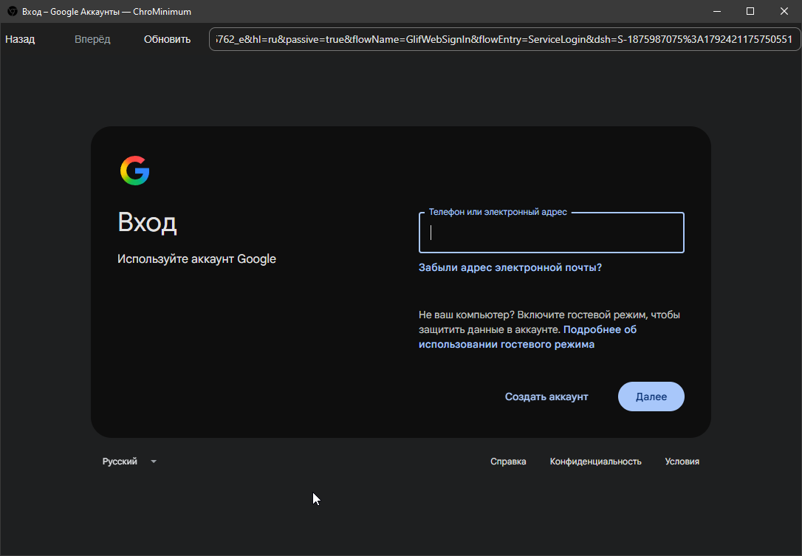
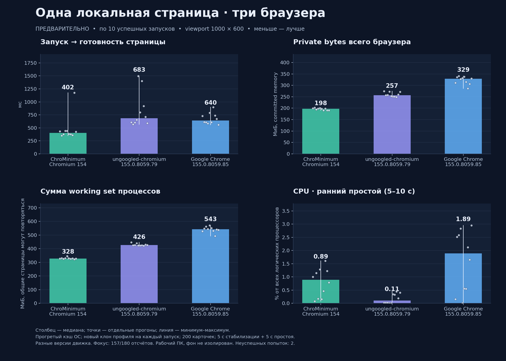

# ChroMinimum

**Один сайт. Одно окно. Минимум лишнего.**



ChroMinimum — минималистичный браузер на **Rust + Chromium (CEF)** для тех, кому нужен доступ к сайту, а не десятки функций вокруг него. В первом прототипе нет даже вкладок: только страница, адресная строка и базовая навигация. Можно открывать сайты и PDF.

[Скачать экспериментальную сборку](https://github.com/SargeMadovsky/ChroMinimum/releases) · [Сборка из исходников](#собрать)

## Зачем браузер, в котором почти ничего нет

Если вы каждый день открываете один и тот же сайт, большая часть возможностей обычного браузера может просто не понадобиться. ChroMinimum исследует простую идею: оставить современный веб-движок и убрать лишнее из оболочки. Открыть нужную страницу, поработать и закрыть окно.

Цель — очень лёгкий и быстрый браузер с низкими накладными расходами, полезный в том числе на старом железе. **Общее преимущество в быстродействии пока не доказано.** Отсутствие вкладок само по себе не доказывает экономию памяти: внутри остаётся Chromium, а тяжёлый сайт остаётся тяжёлым. Первые локальные замеры показаны в разделе [предварительного тестирования](#предварительное-тестирование); сравнений на реальных сайтах и испытаний на старых компьютерах пока нет. Безопасность ради скорости не отключается.

## Предварительное тестирование

Локальное сравнение на Windows от **20 октября 2026 года**: одна тестовая страница, по 10 успешных запусков каждого браузера, viewport 1000×600 и новый клон тестового профиля на каждый запуск. Кэш ОС прогрет. Столбцы показывают медианы, точки — отдельные прогоны, линии — минимум и максимум.

[](assets/readme/browser-comparison-2026-10-20.png)

**Это первые результаты конкретных сборок, а не доказательство общего превосходства браузера.** Версии движка различаются (Chromium 154 и 155), фон ПК не изолирован, фокус окна менялся; две неуспешные попытки исключены. Сумма working set может повторно учитывать общие страницы памяти. CPU измерен в раннем простое (5–10 секунд); у ungoogled-chromium он ниже. Реальные сайты и старое железо в этом тесте не проверялись. Нажмите на график, чтобы открыть его в полном размере.

## Кому это может пригодиться

- **Тем, кто пользуется одним сайтом:** почтой, форумом, рабочим порталом или одной веб-программой — и хочет отдельное простое окно для этой задачи.
- **Владельцам старых компьютеров:** как эксперимент с минимальной оболочкой. Выигрыш и пригодность для конкретного железа ещё предстоит проверить.
- **Разработчикам парсеров и кроулеров:** как возможная основа для задач, которым нужен рендеринг страниц и JavaScript. Готового API автоматизации, headless-режима и интерфейса управления обходом в прототипе нет; сейчас это браузер с окном, а не готовый инструмент сбора данных.

## Что есть сейчас

- Адресная строка на всю свободную ширину.
- Назад / вперёд, обновить / остановить.
- Ctrl+L, F5; изменение размера, сворачивание и разворачивание окна.
- Без вкладок и пользовательских плагинов в первом прототипе.

## Скачать

Готовая экспериментальная сборка: [v0.0.1-alpha.2](https://github.com/SargeMadovsky/ChroMinimum/releases/tag/v0.0.1-alpha.2) (Windows x64, Linux x64, macOS ARM64).

| Платформа | Состояние |
|---|---|
| Windows x64 | Прототип проверен локально; release-сборка и smoke-тест в CI |
| Linux x64 | Экспериментальный порт; сборка и smoke-тест в CI |
| macOS Apple Silicon | Экспериментальный порт; сборка и smoke-тест в CI |

Распакуйте архив целиком. Windows: `chrominimum.exe`. Linux: `./run.sh` (нужны системные GTK/NSS/GBM-библиотеки и доступная песочница Chromium). macOS: `chrominimum.app`; сборка пока без нотарификации Apple. Состав каждого выпущенного релиза и фактические результаты проверок указаны в его описании.

Это ранний прототип: нет полноценного менеджера загрузок и законченной системы разрешений. В Windows есть подписанный обновлятор ядра; ежедневная подготовка обновлений включена, подпись и публикация каждого нового пакета требуют ручного подтверждения владельца в GitHub. Linux/macOS пока без обновлятора. Popup пока заблокированы. Наличие sandbox в сборке не заменяет независимый аудит; такой аудит ещё не проводился.

## Собрать

В Windows alpha.2 добавлены подписанный обновлятор и кнопка «Обновления ядра»; старый релиз alpha.1 их не содержит. [Устройство и ограничения](docs/ENGINE_UPDATES.md), [предварительные замеры стоимости](docs/UPDATER_PERFORMANCE.md).

Требуются Rust **1.99.1**, CMake и Ninja. Chromium скачивается готовыми бинарниками, его исходники собирать не нужно.

Windows: установите MSVC и Windows SDK по [инструкции](docs/SETUP_WINDOWS.md), затем:

```powershell
.\scripts\build.ps1 -Release
```

Linux/macOS:

```sh
bash scripts/build.sh
```

Результат: `target/release-bundle/`. Зависимости и команды CI см. в [build.yml](.github/workflows/build.yml). [Подробнее о разработке](docs/DEVELOPMENT.md).

## Лицензия

Собственный код — [MIT](LICENSE). Chromium, CEF и Rust-библиотеки имеют собственные лицензии: см. [THIRD_PARTY.md](THIRD_PARTY.md), `CREDITS.html` и `LICENSES-RUST.html` в релизном архиве.
