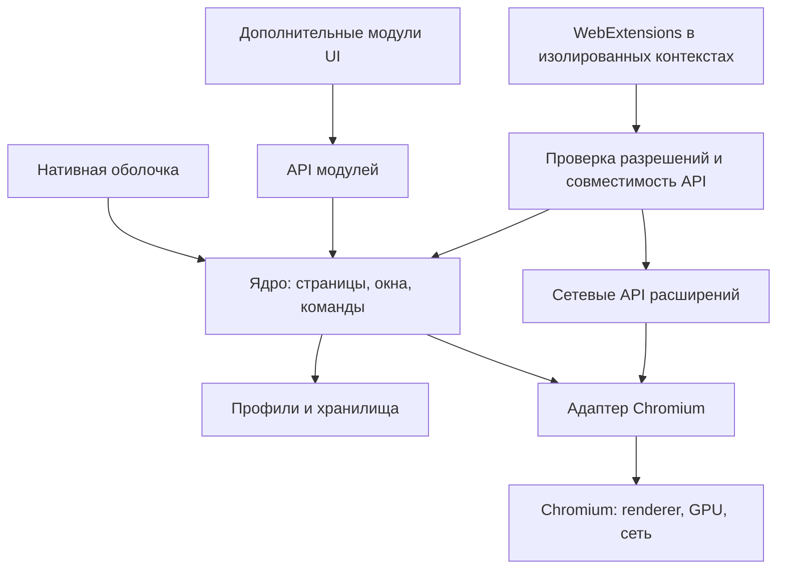

# Архитектура

Статус: проект границ компонентов; реализация и конкретный движковый адаптер не выбраны.

Текущий срез реализации по решению владельца от 2026-10-19: приложение, минимальные UI/ядро и адаптер Chromium, одна страница и встроенный PDF viewer. Компоненты расширений и модулей на диаграмме — будущий объём. Для базового прототипа CEF исследуется без предварительной приёмки MV2; это не закрепляет его для будущей платформы расширений.

Первый технический срез реализован в src/lib.rs без преждевременного разделения на crates. После проверки пользователем штатная Chrome toolbar заменена собственной панелью CEF Views: Textfield и три LabelButton. Общее UI-состояние Navigation используется делегатами ввода, кнопок, адреса и загрузки; ссылки освобождаются при закрытии браузера/окна. Windows bootstrap загружает Rust DLL, инициализация сохраняет sandbox. src/bin/bundle.rs упаковывает DLL с runtime и меняет только icon resources скопированного exe; scripts/build.ps1 подключает MSVC и собирает оба артефакта. Ограничения текущей реализации перечислены в README; это ещё не полная реализация схемы ниже.

## Компоненты

Обновление Windows-движка: [ENGINE_UPDATES.md](ENGINE_UPDATES.md), решение D018. Отдельный Rust-загрузчик проверяет подписанные пакеты и запускает полные комплекты CEF + соответствующий sandbox bootstrap + адаптер. Кнопка в нативной панели и редкий таймер запускают временный процесс обновлятора; HTTP/криптография/распаковка в DLL браузера не добавлены. Состояние и каталог профиля отделены от версий ядра.

Схема логическая: поддержка WebExtensions использует возможности движка, где они доступны. Это не обещание написать полную эмуляцию Chrome и Firefox API на Rust.

## Ответственность

| Компонент | Владеет | Ограничения |
|---|---|---|
| Приложение | Запуск, конфигурация, завершение, сборка поставки | Не содержит бизнес-логику расширений |
| Ядро | PageId/WindowId, навигация, сессия, команды и события | Единственный посредник привилегированных операций |
| UI | Адресная строка, навигация, диалоги и представления | Не управляет памятью движка напрямую |
| Адаптер движка | FFI, callback, процессы и контексты Chromium | Версионные особенности локализованы здесь |
| Совместимость расширений | Manifest, разрешения, API, сообщения и UI расширений | Поддержка каждого API подтверждается тестами |
| Хранилище | Раздельные профили, настройки и данные модулей | Приватный режим без записи истории и постоянных site data |
| Модули | Дополнительное поведение и представления | Отсутствие работы после отключения |

## Процессы и границы доверия

Использовать многопроцессную модель Chromium: привилегированный browser process, renderer и вспомогательные процессы. Точный процесс расширения зависит от выбранной версии движка; отдельный процесс на каждое расширение не обещается.

Веб-контент и расширения не получают прямой доступ к Rust-ядру. IPC проверяет отправителя, профиль, страницу, разрешение, размер сообщения и актуальность идентификаторов. Нельзя предоставлять странице универсальную команду исполнения нативного кода.

Первичные встроенные модули могут компилироваться с приложением и считаются доверенными. Сторонний нативный код в browser process запрещён по умолчанию. Будущий WASM host потребует отдельного решения и модели разрешений.

## Основные потоки

Навигация: ввод → разбор URL/поиска → команда ядру → адаптер → событие движка → обновление UI. Поисковый провайдер задаётся явно; ошибка URL не должна незаметно передавать чувствительный ввод в поиск.

Сетевой запрос: движок применяет разрешённые декларативные и динамические правила. Порядок конфликтов, deadlines и обработка сбоя расширения должны быть определены по совместимости и проверены. Не пересылать каждый запрос через UI-поток.

Завершение: прекратить новые операции → закрыть страницы и обработчики → завершить host модулей → сбросить допустимые данные → завершить движок и подпроцессы. Отмена закрытия при несохранённых данных должна работать предсказуемо.

## Конкурентность и состояние

UI-поток не ждёт диска, сети и длительного обработчика расширения. Соблюдать требования потоков конкретного CEF API. Передавать типизированные команды и события, ограничивать очереди и размеры сообщений. Для callback после закрытия страницы проверять поколение идентификатора. Не переносить объекты FFI между потоками без подтверждённых гарантий.

## Возможная структура исходников

После этапа 00: crates/browser-app, browser-core, browser-engine-cef (если выбран CEF), browser-ui. Слои extensions и modules выделяются по мере появления реализации. Не создавать все crates заранее. Адаптер ограничивает связанность, но не делает замену движка бесплатной.

## Выбор интеграции

CEF + cef-rs исследуется первым. Chrome style, Alloy style, размещение окон и off-screen rendering проверяются на конкретной закреплённой версии. Не использовать старую модель двух независимых runtime как неизменный современный факт: см. SOURCES. Slint — кандидат, а не обязательная зависимость.

Если CEF не удовлетворяет расширениям, сравнить стоимость небольшого поддерживаемого набора патчей с собственным форком Chromium. Замораживание старого уязвимого Chromium решением не является.
